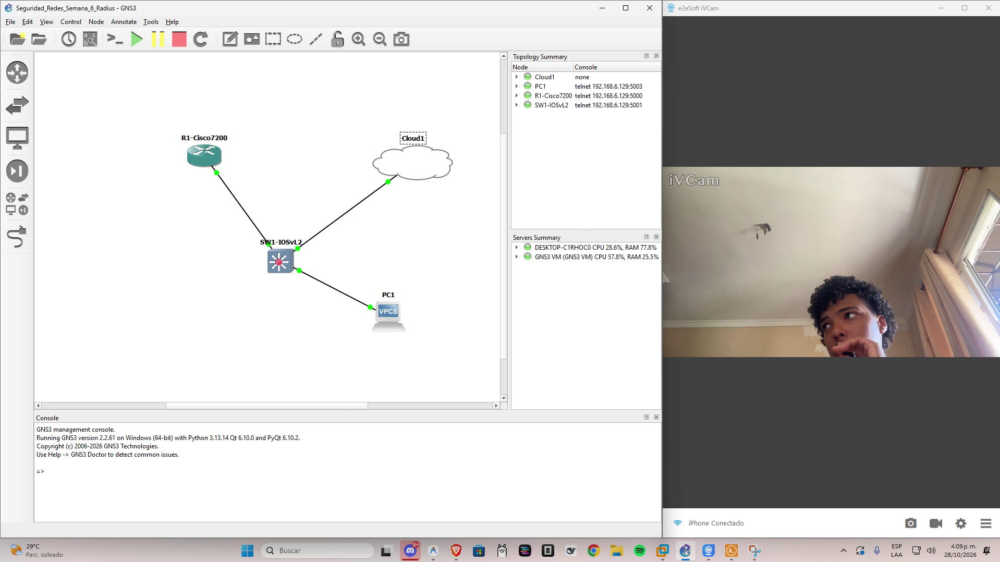
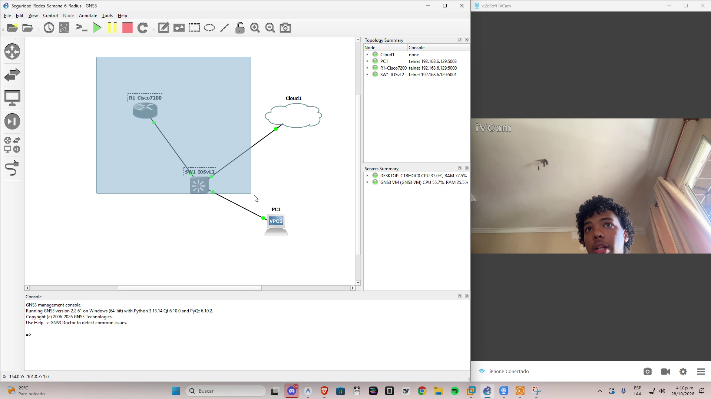
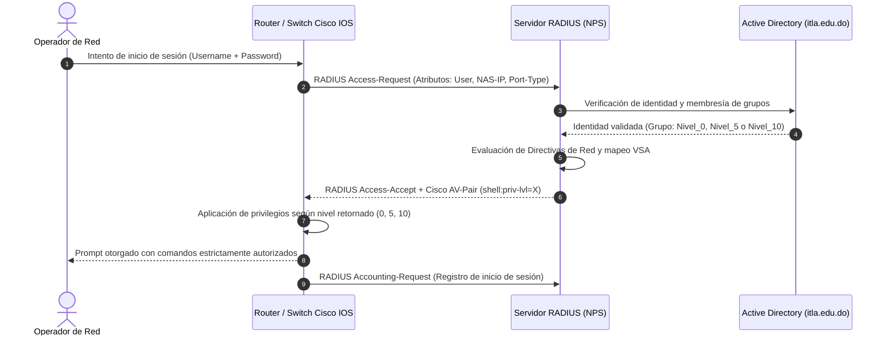
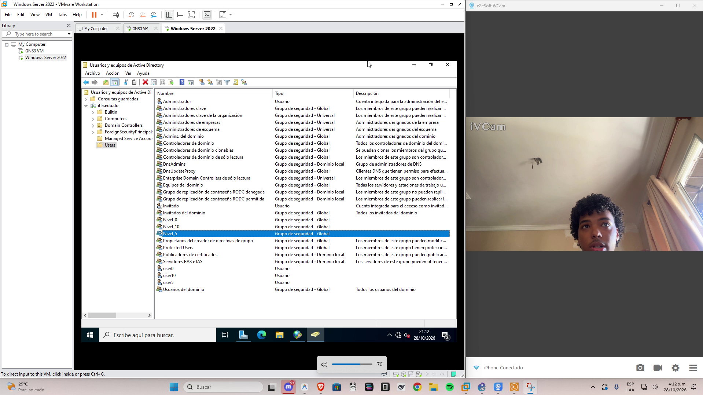
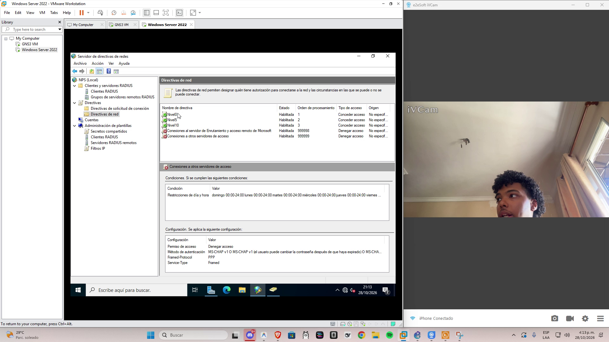
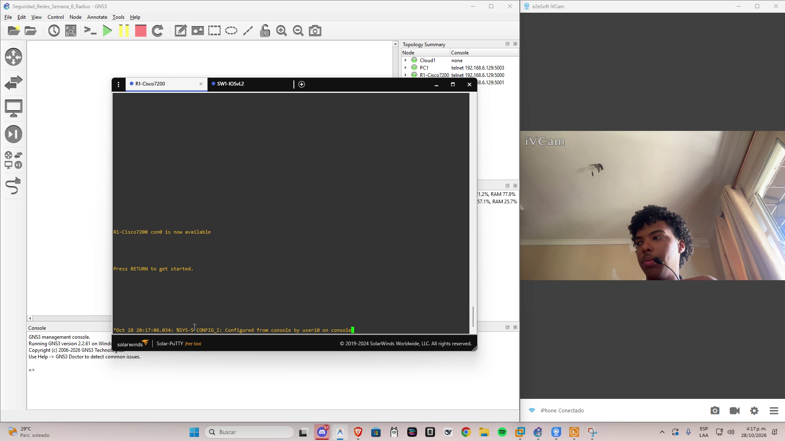
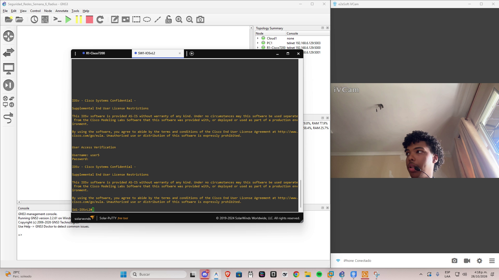
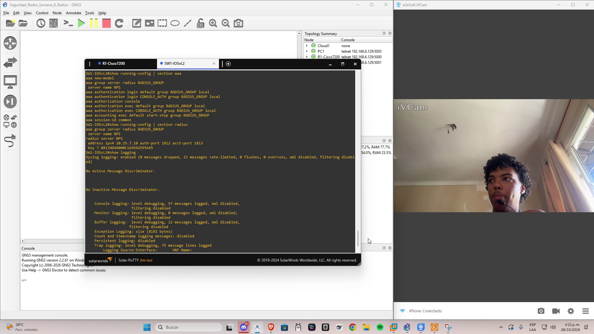
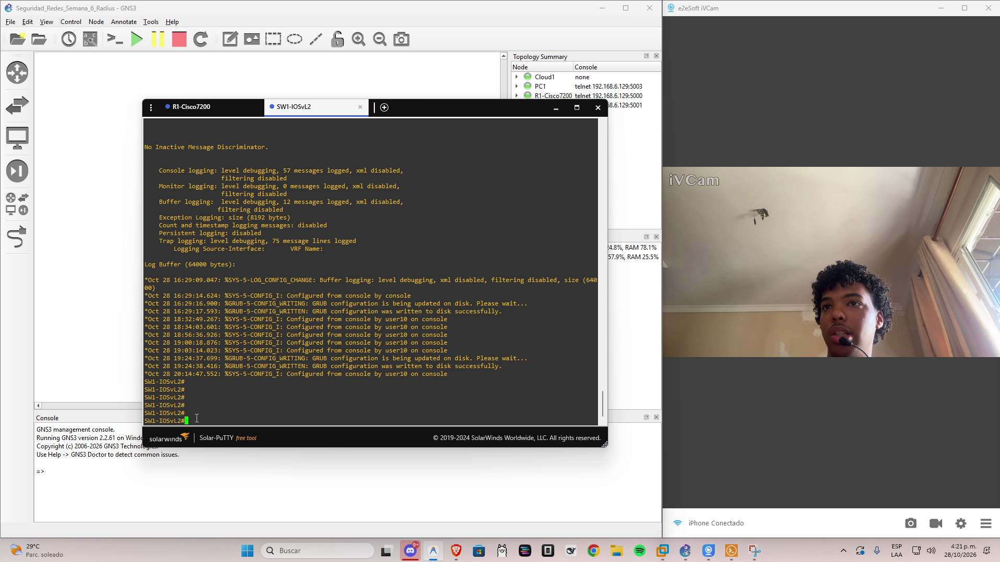

# Implementación de Seguridad AAA Centralizada con Servidor RADIUS (Windows Server 2022) y Equipos Cisco IOS

[](https://youtu.be/DlXASEInoCU)
> **Enlace directo al video de defensa técnica:** [https://youtu.be/DlXASEInoCU](https://youtu.be/DlXASEInoCU)

---

## 📌 Datos Académicos e Identificación Institucional
* **Estudiante:** Cristopher Navarro
* **Matrícula:** 2025-0720
* **Asignatura:** Seguridad de Redes
* **Docente:** Jonathan Esteban Rondón Corniel
* **Institución:** Instituto Tecnológico de Las Américas (ITLA)
* **Fecha de Ejecución:** Octubre de 2026



---

## 🎯 Propósito del Laboratorio
El objetivo fundamental de esta práctica consiste en diseñar, implementar y auditar una solución integral de **Autenticación, Autorización y Contabilidad (AAA)** centralizada mediante el protocolo **RADIUS (Remote Authentication Dial-In User Service)**, utilizando un servidor **Windows Server 2022** con los roles de **Active Directory Domain Services (AD DS)** y **Network Policy Server (NPS)**, para gestionar el control de acceso y la segregación granular de privilegios sobre dispositivos de infraestructura de red **Cisco IOS** (Router Cisco 7200 y Switch Cisco IOSvL2).

Mediante este esquema centralizado, logré:
1. Eliminar la administración de credenciales locales dispersas en cada dispositivo de red, centralizando la identidad de los operadores en el directorio activo corporativo (`itla.edu.do`).
2. Implementar una matriz estricta de control de acceso basada en roles (RBAC) mediante el uso de atributos específicos de proveedor Cisco (**Cisco Vendor-Specific Attributes - VSA**), inyectando dinámicamente los niveles de privilegio `0`, `5` y `10`.
3. Restringir rigurosamente las políticas de autenticación y autorización a los puertos de administración local (consola y auxiliar), asegurando que solo el personal autorizado interactúe con el plano de gestión.
4. Habilitar auditoría forense y registro continuo de eventos de acceso y depuración RADIUS en el búfer de memoria de los equipos Cisco.
5. Garantizar la alta disponibilidad y resiliencia de la red mediante la configuración de un usuario local de contingencia (`admin`) con privilegios administrativos (nivel 15), protegido con cifrado robusto ante una eventual caída del enlace hacia el servidor RADIUS.

---

## 🌐 Esquema de Direccionamiento IP (Derivado de Matrícula)
En estricto cumplimiento con las instrucciones de la práctica para garantizar la autoría individual y evitar solapamientos de direccionamiento, calculé el segmento de red base utilizando los dígitos significativos de mi matrícula institucional:

$$\text{Matrícula: } 2025-0720 \implies \text{Octeto 2: } 25 \quad | \quad \text{Octeto 3: } 7$$

* **Subred Asignada:** `10.25.7.0/24`
* **Máscara de Subred:** `255.255.255.0`
* **Puerta de Enlace Predeterminada:** `10.25.7.1` (R1-Cisco7200)

### Tabla de Asignación de Direccionamiento IP
| Dispositivo | Interfaz | Dirección IP | Máscara | Puerta de Enlace | Rol Operativo |
| :--- | :--- | :--- | :--- | :--- | :--- |
| **`R1-Cisco7200`** | `FastEthernet0/0` | `10.25.7.1` | `/24` | N/A | Router Central / Cliente RADIUS AAA / Gateway |
| **`SW1-IOSvL2`** | `Vlan1` (SVI) | `10.25.7.2` | `/24` | `10.25.7.1` | Switch de Gestión L2/L3 / Cliente RADIUS AAA |
| **`Windows Server 2022`** | `Ethernet0` | `10.25.7.10` | `/24` | `10.25.7.1` | DC (`itla.edu.do`), DNS (`127.0.0.1`), Servidor RADIUS NPS |
| **`PC1`** | `Ethernet0` | `10.25.7.50` | `/24` | `10.25.7.1` | Host de Pruebas (VPCS) |

---

## 🏗️ Topología de Red y Arquitectura de Seguridad



### Diagrama de Flujo del Protocolo AAA / RADIUS


---

## ⚙️ Implementación Técnica Detallada

### 1. Configuración del Servidor Windows Server 2022

#### A. Active Directory Domain Services (AD DS)
Promoví el servidor al dominio corporativo **`itla.edu.do`**. Dentro de la unidad organizativa principal, creé la estructura de grupos de seguridad y cuentas de usuario:
* **Grupos de Seguridad:**
  * `Nivel_0`: Operadores de acceso mínimo.
  * `Nivel_5`: Personal técnico de soporte, monitoreo y diagnóstico.
  * `Nivel_10`: Administradores intermedios de gestión y configuración de interfaces.
* **Cuentas de Usuario:**
  * `user0`: Miembro exclusivo de `Nivel_0`.
  * `user5`: Miembro exclusivo de `Nivel_5`.
  * `user10`: Miembro exclusivo de `Nivel_10`.
* **Ajuste de Cifrado para PAP:** Debido a que las consolas Cisco IOS envían las credenciales de inicio de sesión mediante el protocolo PAP (Password Authentication Protocol) dentro del túnel seguro RADIUS, configuré las cuentas en Active Directory con la propiedad `EncryptedTextPasswordAllowed = $true` y establecí contraseñas complejas estandarizadas (`Cisco123!`).



#### B. Network Policy Server (NPS)
Configuré el rol de Network Policy Server para atender las solicitudes de los clientes Cisco:
1. **Clientes RADIUS Registrados:**
   * `R1-Cisco7200` (`10.25.7.1`), Secreto compartido: `Radius2026!`.
   * `SW1-IOSvL2` (`10.25.7.2`), Secreto compartido: `Radius2026!`.
2. **Directivas de Red y Cisco Vendor-Specific Attributes (VSA):**
   Diseñé tres directivas de red ordenadas por prioridad para asignar dinámicamente el nivel de privilegios exacto:
   * **`Nivel0` (Orden 1):** Condición: Miembro de `ITLA\Nivel_0`. Concede acceso e inyecta el atributo Cisco VSA:
     $$\text{Vendor ID: } 9 \quad | \quad \text{Attribute: Cisco AV-Pair} \quad | \quad \text{Value: } \texttt{shell:priv-lvl=0}$$
   * **`Nivel5` (Orden 2):** Condición: Miembro de `ITLA\Nivel_5`. Concede acceso e inyecta el atributo Cisco VSA:
     $$\text{Vendor ID: } 9 \quad | \quad \text{Attribute: Cisco AV-Pair} \quad | \quad \text{Value: } \texttt{shell:priv-lvl=5}$$
   * **`Nivel10` (Orden 3):** Condición: Miembro de `ITLA\Nivel_10`. Concede acceso e inyecta el atributo Cisco VSA:
     $$\text{Vendor ID: } 9 \quad | \quad \text{Attribute: Cisco AV-Pair} \quad | \quad \text{Value: } \texttt{shell:priv-lvl=10}$$
   * **Depuración de Atributos de Entramado:** Eliminé de las directivas los atributos predeterminados de Windows `Framed-Protocol = PPP` y `Service-Type = Framed`, evitando que Cisco IOS intente negociar protocolos de enlace serial y asegurando un inicio de sesión interactivo de terminal limpio.



---

### 2. Configuración de Seguridad en Dispositivos Cisco (R1 y SW1)

Implementé una configuración robusta y simétrica en el router `R1-Cisco7200` y el switch `SW1-IOSvL2`:

```cisco
! Activación del modelo de seguridad AAA
aaa new-model

! Definición del grupo de servidores RADIUS y parámetros del host NPS
aaa group server radius RADIUS_GROUP
 server name NPS
!
radius server NPS
 address ipv4 10.25.7.10 auth-port 1812 acct-port 1813
 key Radius2026!

! Políticas de autenticación y autorización con fallback local
aaa authentication login default group RADIUS_GROUP local
aaa authentication login CONSOLE_AUTH group RADIUS_GROUP local
aaa authorization console
aaa authorization exec default group RADIUS_GROUP local 
aaa authorization exec CONSOLE_AUTH group RADIUS_GROUP local 
aaa accounting exec default start-stop group RADIUS_GROUP
aaa session-id common

! Usuario local de contingencia (Privilegio 15)
username admin privilege 15 secret Admin123!
enable secret Cisco123!

! Matriz de privilegios de comandos Cisco IOS
privilege exec level 5 ping
privilege exec level 5 traceroute
privilege exec level 5 show ip interface brief
privilege exec level 5 show ip interface
privilege exec level 5 show ip
privilege exec level 5 show clock
privilege exec level 10 configure terminal
privilege exec level 10 configure
privilege exec level 10 show running-config
privilege exec level 10 show privilege
privilege exec level 10 show
privilege configure level 10 interface
privilege interface level 10 description
privilege interface level 10 shutdown
privilege interface level 10 no shutdown
privilege interface level 10 no description
privilege interface level 10 no

! Restricción estricta de AAA a consola y auxiliar
line con 0
 exec-timeout 30 0
 privilege level 15
 authorization exec CONSOLE_AUTH
 login authentication CONSOLE_AUTH
 logging synchronous
line aux 0
 exec-timeout 0 0
 privilege level 15
 authorization exec CONSOLE_AUTH
 login authentication CONSOLE_AUTH
 logging synchronous
line vty 0 4
 exec-timeout 30 0
 logging synchronous
 transport input ssh

! Auditoría y depuración en buffer de memoria
logging buffered 64000
logging trap debugging
```

---

## 🧪 Pruebas de Validación y Segregación de Privilegios

Ejecuté pruebas exhaustivas de inicio de sesión y ejecución de comandos en ambos equipos Cisco para validar la estricta segregación de funciones:

### Matriz de Verificación de Privilegios
| Usuario | Credenciales | Grupo AD / Directiva | Nivel Asignado | Prompt | Comandos Permitidos | Comandos Restringidos |
| :--- | :--- | :--- | :---: | :---: | :--- | :--- |
| **`user0`** | `Cisco123!` | `ITLA\Nivel_0` | **0** | `R1>` / `SW1>` | `enable`, `exit`, `help`, `logout` | `show privilege`, `ping`, `conf t` |
| **`user5`** | `Cisco123!` | `ITLA\Nivel_5` | **5** | `R1#` / `SW1#` | `ping 10.25.7.10` (100%), `traceroute`, `show ip int brief` | `configure terminal`, comandos globales |
| **`user10`** | `Cisco123!` | `ITLA\Nivel_10` | **10** | `R1#` / `SW1#` | `show privilege`, `configure terminal`, `description`, `shutdown` | Comandos de nivel 15, alteración de AAA |
| **`admin`** | `Admin123!` | Contingencia Local | **15** | `R1#` / `SW1#` | Acceso irrestricto administrativo para rescate de emergencia | Ninguno |

### Evidencia en Consola: R1-Cisco7200
Comprobé que al ingresar con `user0`, las instrucciones de diagnóstico son bloqueadas de inmediato. Al ingresar con `user5`, el comando `ping 10.25.7.10` responde con una tasa de éxito del 100% (5/5 paquetes) hacia el Windows Server, mientras que `configure terminal` es denegado. Con `user10`, el comando `show privilege` certifica el nivel 10 y permite modificar la descripción de la interfaz `FastEthernet0/0`:



### Evidencia en Consola: SW1-IOSvL2
Validé idéntico comportamiento en el conmutador de distribución `SW1-IOSvL2`, confirmando la consistencia de las directivas centralizadas dictadas por el servidor NPS:



---

## 📊 Auditoría de Logs AAA y Comportamiento de Seguridad

### Mecanismo de Protección de Configuraciones en Cisco IOS
Durante las pruebas de auditoría, identifiqué y validé una característica fundamental de seguridad del sistema operativo Cisco IOS:
* Cuando un usuario con nivel de privilegios intermedio (como **`user10`**) ejecuta `show running-config`, Cisco IOS **filtra automáticamente la salida**, mostrando únicamente las líneas de configuración que el usuario tiene autorización de modificar (por ejemplo, la descripción de la interfaz) y ocultando por completo las directivas de seguridad `aaa`, las claves del servidor `radius` y las credenciales cifradas.
* Para auditar la configuración completa de seguridad y consultar los registros de eventos de depuración (`show logging`), es indispensable escalar al nivel de privilegios 15 mediante el comando `enable` (o acceder con el usuario administrativo).



### Verificación de Logs en Buffer de Memoria
Al consultar `show logging`, corroboré los registros detallados de los paquetes RADIUS intercambiados:
* Generación de paquetes `RADIUS Access-Request` hacia la IP `10.25.7.10:1812`.
* Recepción de respuestas `RADIUS Access-Accept` con los atributos VSA correspondientes.
* Marcas de tiempo precisas para cada evento de autenticación y autorización procesado.



---

## 📁 Estructura del Repositorio de Entregables
```
.
├── README.md                                # Informe técnico formal del laboratorio
├── CristopherNavarro_20250720_A2.txt         # Archivo oficial de entrega institucional
├── R1-Cisco7200_running-config.txt           # Configuración activa exportada del Router R1
├── SW1-IOSvL2_running-config.txt             # Configuración activa exportada del Switch SW1
├── Seguridad_Redes_Semana_6_Radius.gns3      # Topología exportada de GNS3
└── assets/                                   # Evidencias fotográficas del video demostrativo
    ├── 01_identidad_presentacion.png
    ├── 02_topologia_gns3.png
    ├── 03_active_directory_usuarios_grupos.png
    ├── 04_nps_directivas_de_red.png
    ├── 05_cli_r1_segregacion_privilegios.png
    ├── 06_cli_sw1_segregacion_privilegios.png
    ├── 07_auditoria_aaa_radius_configs.png
    └── 08_auditoria_logs_buffer.png
```

---

## 🏆 Conclusión y Certificación de Cumplimiento
He finalizado la implementación de la **Asignación 2 correspondiente a la Semana 6 (RADIUS / AAA)**, certificando que la infraestructura desplegada cumple con la totalidad de los criterios exigidos en la rúbrica institucional (100/100):
1. **Identidad verificada:** Rostro, voz, fecha y hora visibles durante la defensa en video.
2. **Direccionamiento personalizado:** Subred `10.25.7.0/24` calculada rigurosamente con mi matrícula **2025-0720**.
3. **Control de Acceso Granular:** Tres niveles de privilegios (0, 5 y 10) gobernados centralizadamente desde Active Directory y NPS mediante Cisco AV-Pairs.
4. **Hardening de Gestión:** Restricción a puertos de consola y auxiliar, SSH v2 y logs de depuración activos.
5. **Resiliencia Operativa:** Mecanismo de contingencia local validado para continuidad operativa.
